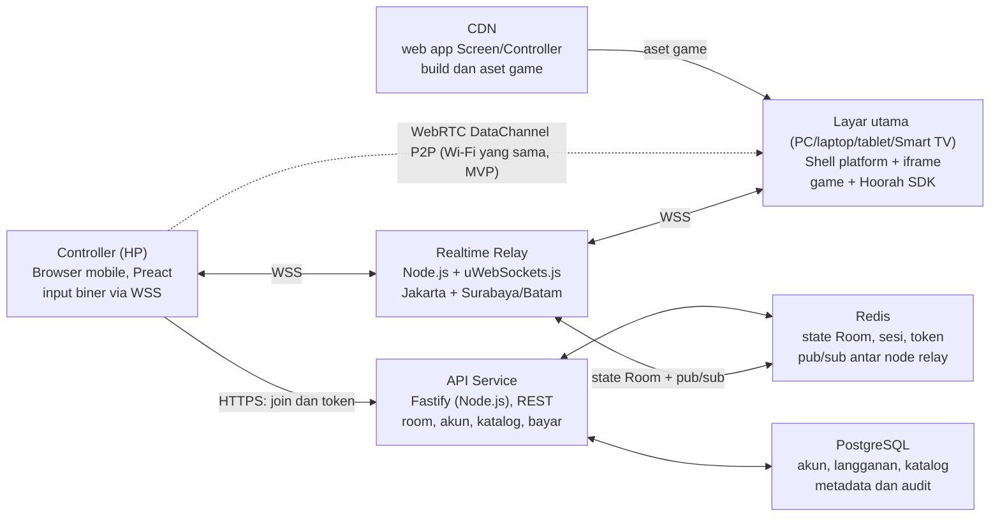
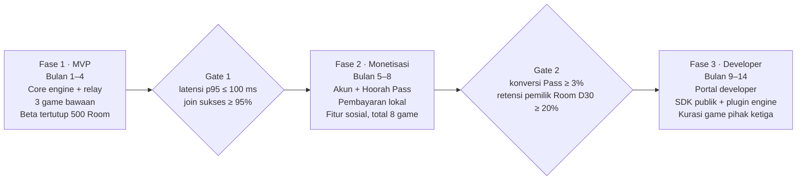

# PRD Hoorah — Platform Game Multi-Layar Berbasis Browser

Nov 12, 2026 · @Fajar

Hoorah mengubah layar mana pun (PC, laptop, tablet, Smart TV) menjadi konsol game, dengan smartphone pemain sebagai kontroler — tanpa install aplikasi, cukup scan QR. Dokumen ini adalah acuan kerja tunggal untuk Product, UI/UX, Frontend, Backend, dan Game Developer.

## 0. Info Dokumen & Glosarium

| Atribut | Nilai |
| --- | --- |
| Versi | 0.1 (Draft untuk review tim) |
| Penyusun | Tim lintas disiplin: Senior PM, Lead Game Programmer & System Architect, Lead UI/UX Designer |
| Cakupan | Fase 1 (MVP) sampai Fase 3 (Rilis publik SDK); pasar Indonesia saja |
| Bahasa kode & API | Bahasa Inggris (nama event, field, endpoint); dokumen bahasa Indonesia |

| Istilah | Definisi |
| --- | --- |
| Screen (Layar utama) | Browser di PC, laptop, tablet, atau Smart TV yang menampilkan game utama dan memutar audio. Satu Screen per Room. |
| Controller | Browser mobile milik pemain yang mengirim input ke Screen. |
| Room | Sesi permainan yang mengikat 1 Screen dengan N Controller, diidentifikasi oleh Room Code. |
| Room Code | Kode 6 angka (ditampilkan "482 917") untuk bergabung ke Room. |
| Host | Controller dengan hak navigasi menu, memilih game, dan mengelola pemain. Default: pemain pertama yang bergabung. Ini peran, bukan status berbayar. |
| Device ID | Identitas numerik perangkat dalam Room (0 = Screen, 1..N = Controller). |
| Session Token | Token rahasia yang disimpan di Controller untuk reconnect tanpa kehilangan slot pemain. |
| Relay Server | Server WebSocket yang meneruskan pesan antara Screen dan Controller. |
| Pemilik Room | Orang yang membuka layar utama dan membuat Room; pihak yang membeli Hoorah Pass. Biasanya juga menjadi Host. |
| Hoorah Pass | Langganan berbayar yang membuka semua fitur premium untuk Room milik satu akun pemilik Room. |
| Hoorah SDK | Library JavaScript untuk game pihak ketiga agar dapat berkomunikasi dengan platform. |
| RTT | Round-trip time: waktu input berangkat dari Controller hingga konfirmasi kembali. |
| CCV | Concurrent Viewers/Users: jumlah pengguna aktif bersamaan pada satu waktu. |

## 1. Ringkasan Eksekutif & Visi Produk

**Visi:** "Setiap layar adalah konsol, setiap HP adalah kontroler." Hoorah menghapus hambatan biaya dan perangkat dalam bermain game bersama secara lokal (*couch co-op / party game*).

### 1.1 Latar Belakang

- Game multiplayer lokal (pesta, keluarga, kantor) masih bergantung pada konsol mahal (Rp5–9 juta) plus kontroler tambahan (Rp800 ribu–1,2 juta per unit).
- Hampir setiap orang sudah membawa smartphone, dan hampir setiap rumah atau kantor punya laptop atau Smart TV dengan browser.
- Browser modern sudah mendukung WebSocket, WebRTC, WebGL, Vibration API, dan DeviceOrientation API — cukup untuk pengalaman konsol ringan tanpa instalasi.
- Pasar Indonesia didominasi Android kelas menengah; instalasi aplikasi baru adalah friksi besar (ruang penyimpanan, kuota, kecurigaan pada aplikasi asing).

### 1.2 Masalah yang Diselesaikan

| Masalah | Dampak | Solusi Hoorah |
| --- | --- | --- |
| Kontroler fisik mahal dan terbatas jumlahnya | Hanya 2–4 orang yang bisa main | Setiap HP menjadi kontroler; hingga 16 pemain |
| Install aplikasi menghambat tamu | Tamu malas ikut, waktu setup lama | Scan QR → main dalam < 30 detik, tanpa install |
| Game pesta butuh konsol khusus | Biaya awal tinggi | Cukup browser di layar besar |
| Developer HTML5 sulit membuat game multi-perangkat | Harus membangun networking sendiri | Hoorah SDK menangani pairing, relay, dan reconnect |

### 1.3 Proposisi Nilai (Value Proposition)

| Segmen | Nilai Utama |
| --- | --- |
| Host acara/pesta | Hiburan grup instan: buka satu URL, semua tamu langsung ikut. Nol perangkat tambahan. |
| Pemain kasual/keluarga | Mudah: tidak perlu akun, tidak perlu install, kontroler yang menyesuaikan diri dengan setiap game. |
| Developer pihak ketiga | Distribusi ke audiens party-gaming plus SDK yang menghilangkan pekerjaan networking. |
| Bisnis (fase lanjutan) | Ice-breaker untuk acara kantor, kafe, sekolah, dan event dengan branding sendiri. |

### 1.4 User Personas

**Persona A — "Rina, Host Pesta" (28 tahun, karyawan swasta, Jakarta)**

- Konteks: sering mengadakan kumpul teman/keluarga di apartemen; punya Smart TV dan laptop.
- Tujuan: hiburan yang membuat semua orang terlibat, termasuk yang tidak "gamer".
- Frustrasi: konsol hanya punya 2 kontroler; tamu bosan menunggu giliran.
- Kebutuhan dari Hoorah: setup < 1 menit, kontrol penuh atas pilihan game (Host), bersedia membayar langganan jika acara sering.

**Persona B — "Keluarga Budi, Pemain Kasual" (Budi 42 tahun, istri, 2 anak 9 dan 14 tahun, plus nenek)**

- Konteks: main saat akhir pekan atau Lebaran; HP beragam, dari Android entry-level sampai iPhone.
- Tujuan: aktivitas bersama lintas generasi.
- Frustrasi: antarmuka rumit, teks kecil, tombol yang tidak jelas.
- Kebutuhan dari Hoorah: kontroler super sederhana, teks besar, tidak perlu membuat akun, tetap jalan di HP lama dan jaringan Wi-Fi rumah yang kurang stabil.

**Persona C — "Dimas, Game Developer Indie" (25 tahun, developer Phaser/Unity, Bandung)**

- Konteks: punya beberapa game HTML5 di itch.io; ingin game-nya dimainkan audiens yang lebih luas.
- Tujuan: merilis game multiplayer lokal tanpa membangun server sendiri.
- Frustrasi: networking real-time rumit; tidak ada audiens untuk game party.
- Kebutuhan dari Hoorah: SDK yang jelas, simulator lokal untuk testing tanpa banyak HP, dokumentasi lengkap, dan dashboard analitik.

### 1.5 Prinsip Produk

1. **Zero-friction join:** dari melihat QR hingga berada di lobi ≤ 30 detik, tanpa akun.
2. **Layar besar adalah panggung, HP adalah alat:** informasi penting ada di Screen; HP hanya menampilkan apa yang dibutuhkan tangan pemain.
3. **Latensi adalah fitur:** input yang terasa lambat sama dengan produk rusak.
4. **Tahan gangguan:** HP terkunci atau sinyal putus tidak boleh merusak permainan orang lain.
5. **Inklusif:** dapat dimainkan oleh anak 7 tahun hingga lansia.

## 2. Alur Pengguna (User Flow) End-to-End

Kedua alur berjalan paralel dan selalu sinkron: setiap perubahan state di Screen (lobi, katalog, game, hasil) mendorong perubahan tampilan di semua Controller dalam ≤ 200 ms.

### 2.1 Alur Layar Utama (Screen)

1. **Buka website** `hoorah.gg` (domain placeholder) di browser perangkat layar utama (PC, laptop, tablet, atau Smart TV).
   1. Deteksi perangkat: jika dibuka di HP, arahkan ke alur Controller dengan opsi "Saya ingin jadi layar utama".
   2. Tampilkan splash 1–2 detik sambil membuka koneksi WebSocket ke region terdekat.
2. **Room dibuat otomatis** tanpa klik.
   1. Server membuat Room Code 6 angka dan Screen Token.
   2. Jika halaman di-refresh dalam 10 menit, Screen Token di `sessionStorage` memulihkan Room yang sama.
3. **Tampilkan QR Code & Room Code** (layar "Join").
   1. QR berisi URL `hoorah.gg/j/ABC123` (kode sudah terisi).
   2. Room Code ditulis besar beserta instruksi "Buka hoorah.gg di HP-mu".
   3. Indikator kualitas jaringan Screen ditampilkan kecil di pojok.
4. **Daftar pemain masuk real-time.**
   1. Setiap pemain muncul sebagai kartu avatar dengan animasi masuk dan efek suara.
   2. Pemain pertama otomatis bertanda mahkota (Host).
   3. Slot kosong terlihat (misal 3/8); bagi pengguna gratis, slot terkunci ditandai ikon gembok Hoorah Pass.
5. **Navigasi katalog game** (dikendalikan Host dari HP).
   1. Katalog berupa grid kartu game; fokus dipindah dengan D-pad di HP Host.
   2. Kartu menampilkan: judul, jumlah pemain min–maks, durasi, genre, label Pass.
   3. Pemain non-Host melihat tampilan "Host sedang memilih game..." di HP mereka.
6. **Mulai game.**
   1. Halaman detail game → Host menekan "Main".
   2. Screen memuat game (iframe terisolasi) dengan progress bar; Controller memuat layout kontroler game tersebut secara bersamaan.
   3. Game mulai saat semua Controller melaporkan `ready` atau batas waktu 15 detik tercapai.
7. **Selesai game & ganti game.**
   1. Game memanggil `endGame(results)` → Screen menampilkan papan skor platform.
   2. Host memilih: "Main Lagi", "Ganti Game" (kembali ke katalog), atau "Akhiri Sesi".
   3. Pengguna gratis: jeda iklan maks 30 detik muncul di sini, tidak pernah di tengah permainan.

### 2.2 Alur Smartphone (Controller)

1. **Scan QR atau ketik URL.**
   1. Via QR: kode sudah terisi, langsung ke langkah 3.
   2. Via URL manual: buka `hoorah.gg`, tampil field Room Code 6 kotak besar dengan keyboard angka. Bila ada layar Hoorah di Wi-Fi yang sama (alamat publik sama, aktif ≤ 30 menit, belum penuh), HP langsung menawarkan "Layar Hoorah di Wi-Fi ini" dengan nama dan avatar pemainnya; satu ketukan untuk bergabung.
2. **Input Room Code.** Validasi langsung; kode salah atau kedaluwarsa memunculkan pesan jelas dan saran "Periksa kode di layar utama".
3. **Input nama & pilih avatar.**
   1. Nama 1–12 karakter, disaring kata kasar.
   2. Avatar dari 24 karakter bawaan + warna pemain unik otomatis.
   3. Nama dan avatar disimpan di `localStorage` untuk sesi berikutnya.
4. **Masuk lobi tunggu.**
   1. HP menampilkan avatar pemain, warna, dan status "Kamu sudah masuk! Lihat layar utama."
   2. HP Host menampilkan kontroler navigasi menu (D-pad + OK + Back).
   3. Mini-interaksi opsional: tombol "Sorak!" yang memunculkan reaksi di Screen.
5. **Kontroler berubah sesuai game.** Saat game dimuat, HP menerima layout kontroler (lihat 3.2) dan menampilkan tutorial singkat 1 layar ("Miringkan HP untuk menyetir").
6. **Interaksi saat bermain.** Input dikirim real-time; feedback lokal instan (animasi tombol + getar) tanpa menunggu server.
7. **Layar hasil akhir.** HP menampilkan peringkat pribadi, skor, dan tombol reaksi; Host menampilkan pilihan Main Lagi / Ganti Game.

### 2.3 Skenario Edge-Case

| Skenario | Deteksi | Perilaku Sistem | Tampilan di Screen | Tampilan di Controller |
| --- | --- | --- | --- | --- |
| HP terkunci / screen sleep | `visibilitychange` = hidden; heartbeat berhenti > 5 detik | Slot pemain ditahan 120 detik; game diberi event `onPlayerPaused` | Avatar redup + ikon zzz | Saat kembali: auto-reconnect, langsung ke state game saat ini |
| Sinyal putus sementara (< 30 detik) | Heartbeat gagal 3x (interval 2 detik) | Controller reconnect otomatis dengan Session Token, backoff 0.5s → 1s → 2s → 4s (maks 8s) | Ikon sinyal kuning di avatar | Banner "Menyambung ulang..." non-blocking; input di-buffer maks 500 ms lalu dibuang |
| Pemain keluar di tengah game | Tombol "Keluar" atau slot habis waktu 120 detik | Game menerima `onDisconnect`; game memutuskan: ganti dengan bot, lanjut tanpa pemain, atau jeda | Toast "Budi keluar" | Kembali ke halaman awal dengan opsi "Gabung lagi" |
| Pemain bergabung saat game berjalan | Join saat state `playing` | Masuk sebagai penonton, kecuali game mengizinkan `lateJoin` | Toast "Sari menonton" | Layar penonton + "Kamu ikut di ronde berikutnya" |
| Host terputus | Heartbeat Host gagal | Tunggu 30 detik; lalu Host pindah otomatis ke pemain aktif paling lama | Mahkota berpindah + toast | Host baru mendapat kontrol menu + getar |
| Screen terputus / tab tertutup | WebSocket Screen putus | Room dibekukan 10 menit; semua Controller ke layar "Menunggu layar utama" | Saat dibuka ulang: Room dipulihkan via Screen Token | Otomatis kembali ke lobi saat Screen pulih |
| Room penuh / batas paket gratis | Join saat jumlah = batas | Join ditolak dengan alasan jelas | Prompt upgrade Hoorah Pass (hanya di Screen) | "Room penuh (2/2). Minta host upgrade." |
| Room Code kedaluwarsa | Tidak ada di Redis | Tolak | — | "Kode tidak ditemukan. Periksa layar utama." |
| Browser HP tidak didukung (sangat lama) | Feature detection (WebSocket, ES2018) | Tampilkan halaman fallback | — | Saran update browser atau pakai Chrome |
| Tab HP berpindah ke aplikasi lain (WhatsApp) | `visibilitychange` | Sama seperti screen sleep | Avatar redup | Saat kembali langsung lanjut |
| Dua tab dengan Session Token sama | Server melihat token aktif ganda | Koneksi terbaru menang, koneksi lama ditutup dengan kode `4001` | — | Tab lama: "Sesi dibuka di tab lain" |

## 3. Spesifikasi Fitur Utama (Functional Requirements)

Prioritas memakai MoSCoW: **M** = Must (MVP), **S** = Should, **C** = Could, **W** = Won't (belum).

### 3.1 Sistem Pairing & Session Management

| ID | Requirement | Prioritas |
| --- | --- | --- |
| PAIR-01 | Room Code 6 angka (1 juta kombinasi), ditampilkan dua kelompok "482 917", diketik dengan keyboard angka. Server membatasi 20 kode salah per menit per alamat (anti tebak). (Keputusan pemilik 2026-11-14; sebelumnya 4 huruf.) | M |
| PAIR-02 | Keunikan dijamin di memori server (MVP satu proses); retry maks 50x jika bentrok. Redis dipakai saat server lebih dari satu (Fase 2). | M |
| PAIR-03 | Kode tidak boleh membentuk kata kasar (blocklist bahasa Indonesia & Inggris). | S |
| PAIR-04 | QR Code berisi deep link `https://hoorah.gg/j/{code}`; di-render client-side di Screen. | M |
| PAIR-05 | Join manual via field kode; input case-insensitive. | M |
| SESS-01 | Masa berlaku Room: aktif selama Screen terhubung; idle (tanpa input apa pun) 30 menit → ditutup; Screen putus → dibekukan 10 menit lalu dihapus. | M |
| SESS-02 | Batas umur Room absolut 12 jam (mencegah room zombie). | M |
| SESS-03 | Batas pemain: Gratis 2 Controller; Hoorah Pass 16 Controller (batas teknis per Room); penonton maks 50. | M |
| SESS-04 | Session Token (128-bit acak) diterbitkan saat join, disimpan di `localStorage`, dipakai untuk reconnect ke slot yang sama. | M |
| SESS-05 | Slot pemain ditahan 120 detik setelah koneksi terputus. | M |
| ROLE-01 | Peran: **Screen** (device 0), **Host** (1 Controller, navigasi menu + kelola pemain), **Player**, **Spectator**. | M |
| ROLE-02 | Host default = pemain pertama yang bergabung; Host dapat menyerahkan mahkota ke pemain lain. | M |
| ROLE-03 | Host dapat mengeluarkan (*kick*) pemain; pemain yang di-kick diblokir dari Room tersebut 10 menit. | S |
| ROLE-04 | Fallback Host otomatis (lihat 2.3). | M |
| ROLE-05 | Screen dapat dikendalikan juga dengan keyboard/mouse/remote TV (arrow + Enter) sebagai cadangan. | S |

### 3.2 Dynamic Virtual Controller Engine

Engine di sisi Controller merender layout dari deskripsi JSON yang dikirim game, sehingga satu web app Controller melayani semua game tanpa deploy ulang.

**Dua mode kontroler:**

| Mode | Cara Kerja | Kapan Dipakai | Kelebihan / Kekurangan |
| --- | --- | --- | --- |
| **Declarative Layout** (default) | Game mengirim JSON berisi komponen standar; engine Hoorah merender | 90% game: aksi, balapan, kuis | Konsisten, ringan, aman, ergonomi terjamin / kustomisasi terbatas |
| **Custom Controller** (Fase 3) | Game menyediakan halaman HTML kontroler sendiri, dimuat dalam iframe sandbox | Game dengan UI unik (kartu, menggambar kompleks) | Bebas / harus direview tim Hoorah, risiko UX tidak konsisten |

**Katalog komponen kontroler standar:**

| Komponen | Output Event | Opsi Konfigurasi | Fase |
| --- | --- | --- | --- |
| `dpad` | `{dir: up/down/left/right, state: down/up}` | 4 atau 8 arah | 1 |
| `joystick` | `{x, y}` float -1..1, dikuantisasi int8 | dead zone (default 0.12), mode fixed/floating | 1 |
| `button` (A/B/X/Y/custom) | `{id, state: down/up}` | label, ikon, warna, ukuran S/M/L, hold vs tap | 1 |
| `tilt` (giroskop/akselerometer) | `{alpha, beta, gamma}` atau `{steer}` | sumbu, sensitivitas, kalibrasi | 1 |
| `swipe` | `{dir, velocity}` | arah yang diizinkan | 2 |
| `text_input` | `{text}` | maks karakter, placeholder | 1 |
| `choice` (pilihan ganda) | `{index}` | 2–6 opsi, teks/gambar | 1 |
| `draw_canvas` | stroke `[x,y]` dinormalisasi, dikirim per 50 ms | warna, ketebalan, batas waktu | 2 |
| `slider` | `{value}` 0..1 | orientasi | 2 |
| `display` (teks/gambar info) | — | konten pribadi pemain (kartu, peran rahasia) | 1 |

**Contoh payload layout:**

```json
{
  "type": "set_layout",
  "orientation": "landscape",
  "theme": { "accent": "player" },
  "zones": {
    "left":  [{ "component": "joystick", "id": "move", "deadZone": 0.12 }],
    "right": [
      { "component": "button", "id": "A", "label": "Lompat", "size": "L" },
      { "component": "button", "id": "B", "label": "Tembak", "size": "M" }
    ]
  },
  "haptics": { "onPress": 15 }
}
```

**Requirement engine:**

| ID | Requirement | Prioritas |
| --- | --- | --- |
| CTRL-01 | Layout dapat diganti kapan pun per pemain (`setLayout(deviceId, layout)`) atau broadcast ke semua. | M |
| CTRL-02 | Pergantian layout ≤ 100 ms setelah pesan diterima (komponen sudah ter-bundle, tanpa fetch). | M |
| CTRL-03 | Izin sensor iOS (`DeviceOrientationEvent.requestPermission`) diminta lewat tombol eksplisit "Aktifkan Sensor" sebelum game yang memakai tilt. | M |
| CTRL-04 | Fallback otomatis: jika sensor ditolak/tidak ada, `tilt` diganti `joystick` horizontal. | M |
| CTRL-05 | Multi-touch: minimal 4 titik sentuh simultan (joystick + 2 tombol + 1 cadangan). | M |
| CTRL-06 | Feedback visual lokal ≤ 16 ms (1 frame) setelah sentuhan, independen dari jaringan. | M |
| CTRL-07 | Game dapat mengirim data tampilan pribadi ke satu pemain (misal kartu tangan, peran rahasia). | M |

### 3.3 Game Storefront & Lobby

| ID | Requirement | Prioritas |
| --- | --- | --- |
| STORE-01 | Katalog grid di Screen dengan fokus yang digerakkan D-pad Host; navigasi melingkar per baris. | M |
| STORE-02 | Kartu game: cover 16:9, judul, ikon jumlah pemain (min–maks), durasi rata-rata, genre, label "PASS". | M |
| STORE-03 | Halaman detail: trailer/GIF auto-play tanpa suara, deskripsi singkat, kontrol yang dipakai (ikon), tombol "Main". | M |
| STORE-04 | Game yang tidak cocok dengan jumlah pemain saat ini diberi label "Butuh min. 4 pemain" dan tombol Main dinonaktifkan. | M |
| STORE-05 | Kategori/rak: Populer, Baru, Untuk 2 Pemain, Pesta Besar (6+), Keluarga, Kuis & Kata. | S |
| STORE-06 | Game Pass yang dipilih pengguna gratis → layar preview + upsell, tanpa memblok navigasi. | S |
| STORE-07 | Pencarian teks via `text_input` di HP Host. | C |
| STORE-08 | Riwayat "Terakhir dimainkan" per Screen (localStorage) atau per akun (Fase 2). | S |
| LOBBY-01 | Lobi menampilkan semua pemain, status koneksi, Host, dan kualitas sinyal per pemain. | M |
| LOBBY-02 | Game memuat aset dengan progress bar; Controller menampilkan tips game selama loading. | M |

### 3.4 Sistem Monetisasi (Freemium / Hoorah Pass)

Model: Hoorah Pass dibeli oleh **pemilik Room** (orang yang membuka layar utama), bukan per pemain — satu langganan membuka fitur untuk semua orang di Room-nya.

| Fitur | Gratis | Hoorah Pass |
| --- | --- | --- |
| Jumlah Controller per Room | 2 pemain | 16 pemain |
| Penonton | 5 | 50 |
| Katalog game | 5 game rotasi bulanan + 2 game tetap | Semua game (termasuk rilis baru di hari pertama) |
| Iklan | Jeda iklan maks 30 detik antar game (maks 1x per 15 menit), tidak pernah di tengah game | Bebas iklan |
| Durasi sesi | Maks 60 menit per Room, lalu harus buat Room baru | Tanpa batas (batas teknis 12 jam) |
| Kustomisasi | Avatar dasar (24) | Avatar premium, tema Screen, nama Room kustom |
| Riwayat & statistik | — | Papan skor sesi, riwayat pemain, highlight |
| Akun | Opsional | Wajib (untuk menautkan langganan) |
| Prioritas server | Standar | Prioritas di region padat |
| Dukungan | FAQ | Email prioritas |

**Harga awal yang diusulkan (validasi via A/B test di Fase 2):**

| Paket | Harga (IDR) | Catatan |
| --- | --- | --- |
| Pass Harian (Party Pass) | Rp15.000 / 24 jam | Untuk acara satu kali; diaktifkan via QRIS/e-wallet |
| Pass Bulanan | Rp49.000 / bulan | Langganan, bisa dibatalkan kapan saja |
| Pass Tahunan | Rp399.000 / tahun | Hemat ±32% |
| Trial | 7 hari gratis | Sekali per akun, butuh metode pembayaran |

**Aturan monetisasi:**

- Upsell hanya ditampilkan di Screen (layar utama), tidak pernah mengganggu HP pemain kecuali pesan singkat saat Room penuh.
- Iklan berupa video/banner di Screen; tanpa iklan pop-up di Controller.
- Tidak ada bagi hasil ke developer: seluruh pendapatan Pass dikelola langsung oleh pemilik platform; game pihak ketiga masuk katalog lewat kurasi.
- Metode pembayaran Indonesia: QRIS, GoPay, OVO, DANA, ShopeePay, kartu kredit, virtual account bank; di Smart TV pembayaran dilakukan dengan scan QR ke HP.

#### 3.4.1 Tahap uji coba: kode Pass bersama (sementara, keputusan pemilik 2026-11-16)

Selama uji coba bersama teman, Hoorah Pass **belum** memakai akun, pembayaran, atau ikatan ke perangkat. Skema ini sementara dan akan ditinjau ulang setelah uji coba.

- Pemilik membuat **kode Pass** di dashboard admin (`/admin/`): catatan, kode (acak 8 huruf/angka tanpa huruf mirip, atau diketik sendiri), waktu berakhir (maks 1 tahun), batas pemain (3–16, bawaan 16), dan opsional batas room yang memakai kode itu bersamaan.
- Kode boleh dipakai di perangkat mana pun. HP mana saja di room (lewat "Punya kode Hoorah Pass?" di kartu Tambah pemain/Ajak teman), atau HP yang ditolak karena room penuh (kolom kode langsung di halaman "Room penuh"), memasukkan kode. Room langsung terbuka sampai batas pemain Pass.
- HP mengingat kode yang berhasil sampai Pass berakhir, lalu mengirimnya otomatis saat masuk room berikutnya.
- Saat Pass berakhir atau dicabut: tidak ada pemain yang dikeluarkan, tetapi kursi tidak bertambah lagi; room baru kembali ke batas gratis. Pemain meminta kode baru ke pemilik.
- Pemilik bisa memperpanjang, mencabut, mengaktifkan lagi, atau menghapus kode; perubahan langsung berlaku di room yang sedang memakainya.
- Server memeriksa semuanya (kode, waktu, batas room, batas percobaan salah 10 per menit per alamat); klien tidak dipercaya.
- Penyimpanan: SQLite bawaan Node (`node:sqlite`, satu file `data/hoorah.db`, di Docker `/data/hoorah.db`). Admin dibuat lewat CLI server (`admin set <username>`), login dengan sesi cookie httpOnly.

### 3.5 Hoorah Game SDK

SDK berbentuk satu file JavaScript (`hoorah-sdk.js`, target < 15 KB gzip) dengan definisi TypeScript, dipakai di dua sisi: **Screen** (game utama) dan **Controller** (opsional, untuk custom controller). Game berjalan dalam iframe; SDK berkomunikasi dengan platform via `postMessage`, dan platform yang memegang koneksi WebSocket.

**Inisialisasi:**

```js
const hoorah = new Hoorah({
  role: "screen",          // "screen" | "controller"
  gameId: "com.studio.balapbajaj",
  minPlayers: 2,
  maxPlayers: 8,
  lateJoin: false,
  orientation: "landscape" // dikirim ke semua Controller
});

hoorah.onReady = () => { /* platform siap, pemain sudah ada */ };
```

**Event (callback) inti:**

| Event | Sisi | Parameter | Kapan Terpicu |
| --- | --- | --- | --- |
| `onReady()` | Screen, Controller | — | SDK terhubung ke platform dan daftar pemain tersedia |
| `onConnect(deviceId)` | Screen | `deviceId: number` | Controller bergabung atau berhasil reconnect |
| `onDisconnect(deviceId)` | Screen | `deviceId` | Controller lepas permanen (slot habis waktu) |
| `onPlayerPaused(deviceId, paused)` | Screen | `deviceId, paused: boolean` | HP terkunci/berpindah aplikasi atau kembali |
| `onMessage(from, data)` | Screen, Controller | `from: number, data: object` | Pesan masuk dari perangkat lain |
| `onInput(deviceId, input)` | Screen | `{componentId, type, value}` | Input dari komponen kontroler standar (sudah ter-decode) |
| `onActivePlayersChange(ids)` | Screen, Controller | `number[]` | Daftar pemain aktif berubah |
| `onPremium(isPremium)` | Screen | `boolean` | Status Hoorah Pass Room berubah |
| `onPause()` / `onResume()` | Screen | — | Platform menampilkan overlay (menu Host, iklan, Screen hilang fokus) |

**Method inti:**

| Method | Sisi | Fungsi |
| --- | --- | --- |
| `sendMessage(to, data, opts?)` | Screen, Controller | Kirim pesan ke `deviceId` tertentu, `0` (Screen), atau `"all"`; `opts.reliable` (default true) |
| `broadcast(data)` | Screen | Alias `sendMessage("all", data)` |
| `setLayout(target, layout)` | Screen | Atur layout kontroler deklaratif untuk satu/semua pemain |
| `setActivePlayers(maxCount)` | Screen | Kunci pemain aktif ronde ini (urutan join); sisanya jadi penonton; memetakan `deviceId` → `playerNumber` 0..N |
| `getActivePlayers()` | Screen, Controller | Daftar `deviceId` aktif |
| `convertDeviceIdToPlayerNumber(id)` / `convertPlayerNumberToDeviceId(n)` | Screen, Controller | Konversi indeks pemain stabil |
| `getProfile(deviceId)` | Screen, Controller | `{nickname, avatarUrl, color, isVip}` |
| `getMasterControllerDeviceId()` | Screen, Controller | Device ID Host saat ini |
| `vibrate(deviceId, pattern)` | Screen | Getar HP pemain (ms atau array pola) |
| `setCustomState(data)` | Screen, Controller | State persisten per perangkat, otomatis dikirim ulang saat reconnect |
| `getServerTime()` | Screen, Controller | Waktu tersinkron (offset NTP-like) untuk game berbasis timing |
| `gameReady()` | Screen | Game selesai memuat aset |
| `endGame(results)` | Screen | Akhiri game; `results` = `[{deviceId, score, rank}]` untuk papan skor platform |
| `showAd()` | Screen | Minta jeda iklan di titik alami (platform yang menentukan apakah iklan muncul) |

**Contoh alur game minimal:**

```js
hoorah.onConnect = (id) => spawnPlayer(id, hoorah.getProfile(id));
hoorah.onInput = (id, input) => {
  if (input.componentId === "move") players[id].move(input.value.x, input.value.y);
  if (input.componentId === "A" && input.value === "down") players[id].jump();
};
hoorah.setLayout("all", layoutBalap);
hoorah.setActivePlayers(8);
```

**Dukungan engine:**

| Engine | Integrasi | Fase |
| --- | --- | --- |
| Phaser 3 / vanilla JS / PixiJS / Three.js | Langsung pakai `hoorah-sdk.js` | 1 (internal) |
| Construct 3 | Plugin addon (.c3addon) dengan Actions/Conditions/Triggers | 3 |
| Unity WebGL | Paket `.unitypackage` dengan bridge `.jslib` ↔ C# (`HoorahManager` MonoBehaviour, event `OnInput`, `OnConnect`) | 3 |
| Godot 4 (Web export) | Addon GDScript memakai `JavaScriptBridge` | 3 |

**Aturan teknis untuk game pihak ketiga:**

- Game di-host di CDN Hoorah, dimuat dalam iframe `sandbox="allow-scripts allow-same-origin"` di subdomain terpisah (`games.hoorah-cdn.com`).
- Ukuran awal unduhan maks 30 MB (disarankan < 15 MB); harus mencapai `gameReady()` < 15 detik di koneksi 10 Mbps.
- Ukuran pesan maks 1 KB per `sendMessage`; rate limit 30 pesan/detik per perangkat (di luar input komponen standar).
- Wajib menangani `onDisconnect` dan `onPlayerPaused` (diperiksa saat review).

## 4. Spesifikasi Desain UI/UX & Ergonomi

Satu sistem desain, dua konteks: Screen dilihat dari jarak 2–4 meter tanpa disentuh; Controller dipegang di tangan dan dioperasikan tanpa dilihat lama. Semua keputusan desain mengikuti dua konteks itu.

### 4.1 Identitas Visual & Branding

**Kepribadian merek:** riang, inklusif, enerjik, "sorak bersama". Nama "Hoorah" dieksplorasi sebagai seruan kegembiraan; logo memakai bentuk wordmark membulat dengan tanda seru/konfeti sebagai simbol.

**Palet warna (usulan, finalisasi oleh desainer):**

| Token | Hex | Penggunaan |
| --- | --- | --- |
| `brand-primary` (Hoorah Orange) | #FF5A1F | CTA utama, logo, fokus |
| `brand-secondary` (Electric Violet) | #6C3BFF | Aksen, label Hoorah Pass |
| `brand-accent` (Sunny Yellow) | #FFD23F | Highlight, mahkota Host, skor |
| `bg-deep` (Night Ink) | #14121F | Latar Screen (gelap mengurangi silau di TV) |
| `bg-surface` | #221F33 | Kartu dan panel |
| `text-high` | #FFFFFF | Teks utama di latar gelap |
| `success` / `warning` / `danger` | #2BD67B / #FFB020 / #FF3B5C | Status koneksi, notifikasi |

**Warna pemain (8 warna dasar, diulang dengan pola untuk pemain 9–16):** Merah #FF4D4D, Biru #3DA9FC, Hijau #2BD67B, Kuning #FFD23F, Ungu #A66CFF, Oranye #FF8A3D, Pink #FF6FB5, Toska #22D3C5. Setiap warna dipasangkan dengan **bentuk/ikon** unik agar tetap terbedakan oleh pengguna buta warna.

**Aturan kontras:** teks wajib memenuhi WCAG 2.2 AA (4.5:1 untuk teks biasa, 3:1 untuk teks besar ≥ 24 px); di Screen ditargetkan 7:1 karena TV sering diatur terlalu terang/redup.

**Tipografi:**

| Peran | Font | Alasan |
| --- | --- | --- |
| Display (judul, Room Code, skor) | Baloo 2 (ExtraBold) | Membulat, ramah, sangat terbaca dari jauh; open-source |
| UI & body | Plus Jakarta Sans | Dirancang di Indonesia, x-height tinggi, mendukung semua karakter Latin |
| Monospace (Room Code alternatif) | JetBrains Mono | Membedakan karakter yang mirip |

**Ilustrasi & ikonografi:** gaya flat dengan outline tebal (3–4 px pada 48 px), sudut membulat, karakter avatar "blob" ekspresif yang netral budaya. Ikon memakai set tunggal (misal Phosphor Bold) untuk konsistensi. Animasi mikro: memantul (*bouncy*, easing `cubic-bezier(.34,1.56,.64,1)`), durasi 200–400 ms.

**Audio branding:** jingle "Hoorah!" 1,5 detik saat Room siap, efek suara unik per pemain saat join. Audio hanya diputar di Screen; Controller senyap secara default.

**Musik per game:** setiap game punya lagu orisinal sendiri dengan genre dan instrumen yang mudah dikenali, bukan pola pendek yang sama:
- **Beranda/lobi:** lounge santai.
- **Kuis Nusantara:** funk acara kuis.
- **Tarik Tambang:** drumband 17-an.
- **Rusun:** marimba jenaka.
- **Bajaj Rush:** satu lagu per sirkuit (dangdut koplo di kota, tropis di pantai, nuansa Sunda dengan angklung di puncak, cepat dan tegang di arena).
- **Jago Masak:** ayunan bernuansa keroncong.

Lagu sepanjang 16–32 birama dengan beberapa bagian, berganti dengan crossfade, disintesis Web Audio (tanpa file audio) dan tetap ringan untuk Smart TV.

### 4.2 Desain Layar Utama (10-Foot UI)

| Aspek | Aturan |
| --- | --- |
| Kanvas acuan | 1920×1080; skala responsif ke 1280×720 hingga 3840×2160 memakai unit `vh`/`clamp()` |
| Safe area (overscan TV) | Konten penting di dalam margin 5% tiap sisi (96 px horizontal, 54 px vertikal pada 1080p) |
| Ukuran font minimum | Body 28 px; label sekunder 24 px (minimum mutlak); judul 48–64 px; Room Code 120–160 px |
| Fokus visual | Satu titik fokus per layar; elemen yang difokus diperbesar 1.08x + outline 6 px `brand-primary` + glow |
| Hierarki | Maks 3 tingkat informasi; maks 6 kartu game terlihat per baris |
| Navigasi | Hanya arah 4 + OK + Back (mencerminkan D-pad HP & remote TV); tanpa hover/mouse-only |
| Transisi | Slide/scale 300–500 ms; tidak ada cut kasar; menghormati `prefers-reduced-motion` |
| Teks bergerak | Tidak ada teks penting yang bergerak/berkedip; teks bergulir maks kecepatan 60 px/detik |
| Status persisten | Pojok kanan atas: Room Code kecil + jumlah pemain, selalu terlihat di semua layar (kecuali saat game layar penuh, muncul saat ditekan menu) |
| Overlay sistem | Toast di bagian atas tengah, maks 2 sekaligus, 3 detik, tidak menutupi area game |

**Tata letak layar Join/Lobi (1080p):**

- Kiri (40%): QR Code ≥ 360×360 px dengan quiet zone putih, di bawahnya URL dan Room Code besar.
- Kanan (60%): grid slot pemain 4×2 (atau 4×4 untuk Pass) dengan avatar 160 px + nama 32 px.
- Bawah: instruksi 3 langkah bergambar ("Scan → Tulis nama → Main!").

### 4.3 Desain Kontroler Mobile (Ergonomi Layar Sentuh)

**Thumb-zone & penempatan:**

- Mode **landscape** (game aksi): kontrol arah di sepertiga kiri bawah, tombol aksi di sepertiga kanan bawah; pusat kontrol berada 25–35% dari tepi bawah dan ≥ 48 px dari tepi kiri/kanan (menghindari gesture back Android dan lengkungan layar).
- Mode **portrait** (kuis, menggambar, menu): aksi utama di 40% bagian bawah layar; area atas untuk info (nama, skor, instruksi) yang hanya dibaca.
- Tombol aksi utama (A) paling besar dan paling dekat dengan posisi alami ibu jari kanan; tombol sekunder membentuk busur di atasnya.

**Ukuran target sentuh:**

| Elemen | Ukuran Minimum | Ukuran Disarankan | Jarak Antar Target |
| --- | --- | --- | --- |
| Tombol aksi game | 64×64 px (±12 mm) | 80–96 px | ≥ 16 px |
| Joystick (area basis) | diameter 120 px | 140–160 px | — |
| Tombol menu/sistem | 48×48 px | 56 px | ≥ 8 px |
| Pilihan jawaban (kuis) | tinggi 72 px, lebar penuh | tinggi 88 px | ≥ 12 px |

Area sentuh aktual (hitbox) 20% lebih besar dari visual tombol; tombol dirender di posisi tetap (tidak bergeser saat layout berubah dalam satu game).

**Pencegahan accidental touch:**

| Risiko | Mitigasi |
| --- | --- |
| Tidak sengaja tekan Back browser / gesture back | `history.pushState` + tangkap `popstate` → tampilkan dialog "Keluar dari game?"; margin aman 48 px di tepi kiri/kanan |
| Pull-to-refresh | `overscroll-behavior: none` pada `html, body` |
| Zoom ganda / pinch | `touch-action: none` pada area kontroler; meta viewport `user-scalable=no` |
| Seleksi teks & menu konteks long-press | `user-select: none`, `-webkit-touch-callout: none`, cegah `contextmenu` |
| Tutup tab / refresh tidak sengaja | `beforeunload` warning saat game berjalan; jika tetap ter-refresh, Session Token memulihkan slot |
| Address bar muncul/menutupi | Tombol "Layar Penuh" (Fullscreen API) di lobi; iOS Safari: anjuran "Tambahkan ke Layar Utama" (PWA standalone) |
| Notifikasi masuk menutupi tombol | Tidak ada tombol kritis di 15% atas layar pada mode landscape |
| Layar mati otomatis | Screen Wake Lock API saat lobi/game aktif; fallback video senyap 1 px loop untuk browser tanpa Wake Lock |

**Haptic feedback:**

- Pakai `navigator.vibrate()`; pola standar: tap tombol 10–15 ms, aksi berhasil 30 ms, terkena/kalah `[50, 30, 50]`, giliran kamu `[100, 50, 100]`.
- iOS Safari tidak mendukung Vibration API: kompensasi dengan feedback visual lebih kuat (tombol mengecil 0.92x + flash warna) dan opsi suara klik lokal.
- Pengaturan per pemain: Getar On/Off, disimpan di `localStorage`.

**Orientasi layar:**

- Game mendeklarasikan orientasi di `setLayout` (`portrait` | `landscape`).
- Coba `screen.orientation.lock()` saat fullscreen (Android Chrome). Jika gagal (iOS), tampilkan overlay "Putar HP-mu" dengan animasi hingga orientasi benar.
- Lobi, input nama, dan menu Host selalu portrait.

**Tema per game:** selama game berjalan (termasuk layar hasil di dalam game), tampilan HP mengikuti dunia game tersebut: latar, warna, dan bentuk tombol (mis. aspal dan pedal untuk Bajaj Rush, ubin dapur dan talenan untuk Jago Masak), supaya kontroler terasa bagian dari game, bukan panel umum. Lobi dan pengaturan memakai gaya Hoorah netral. Latar dibuat ringan (SVG/CSS, tanpa file gambar besar) dan tidak boleh mengurangi keterbacaan tombol.

**Aksesibilitas Controller:** mode "Tombol Besar" (skala 1.25x), mode kontras tinggi, label teks di semua ikon tombol, dukungan bahasa Indonesia & Inggris sejak MVP.

### 4.4 Daftar Komponen UI & Layar MVP (Design System)

**Komponen dasar (design tokens + library Figma):**

- Foundations: warna, tipografi (skala Screen & Controller terpisah), spacing (kelipatan 8), radius (12/20/32), elevasi, motion tokens, ikon.
- Komponen Screen: Kartu Game (default/fokus/terkunci), Slot Pemain (kosong/terisi/Host/putus/pause), Panel QR, Toast, Modal, Progress Bar Loading, Papan Skor, Badge Pass, Indikator Sinyal.
- Komponen Controller: Tombol Aksi (S/M/L, state normal/pressed/disabled), D-pad, Joystick, Tombol Menu, Input Kode 6 Kotak, Field Nama, Pemilih Avatar, Pilihan Jawaban, Kanvas Gambar, Banner Koneksi, Overlay Rotasi, Dialog Konfirmasi.

**Daftar layar wajib MVP:**

| # | Layar | Perangkat | Catatan |
| --- | --- | --- | --- |
| S-01 | Splash / Menghubungkan | Screen | Termasuk state gagal koneksi |
| S-02 | Join (QR + Room Code + slot pemain) | Screen | State 0 pemain, sebagian, penuh |
| S-03 | Lobi + menu utama | Screen | Setelah ada Host |
| S-04 | Katalog game (grid) | Screen | Fokus, terkunci, tidak cocok jumlah pemain |
| S-05 | Detail game | Screen | Trailer, kontrol, tombol Main |
| S-06 | Loading game | Screen | Progress + status ready per pemain |
| S-07 | Overlay menu jeda (Host) | Screen | Lanjut, Ulang, Keluar ke Katalog |
| S-08 | Hasil / papan skor | Screen | Main Lagi, Ganti Game |
| S-09 | Menunggu Screen / Room dibekukan | Screen | Saat pulih dari putus |
| S-10 | Jeda iklan (gratis) | Screen | Hitung mundur, label "Iklan" |
| S-11 | Upsell Hoorah Pass (placeholder MVP) | Screen | Untuk validasi minat |
| C-01 | Landing / input Room Code | Controller | Termasuk error kode |
| C-02 | Input nama & pilih avatar | Controller |  |
| C-03 | Lobi pemain (non-Host) | Controller | "Lihat layar utama" |
| C-04 | Kontroler navigasi Host | Controller | D-pad + OK + Back + menu |
| C-05 | Izin sensor & fullscreen | Controller | Khusus iOS/Android |
| C-06 | Overlay "Putar HP-mu" | Controller |  |
| C-07 | Kontroler Game 1 (landscape: joystick + 2 tombol) | Controller |  |
| C-08 | Kontroler Game 2 (portrait: pilihan jawaban / teks) | Controller |  |
| C-09 | Penonton | Controller |  |
| C-10 | Menyambung ulang / terputus | Controller | Banner + layar penuh |
| C-11 | Hasil pribadi | Controller | Peringkat + reaksi |
| C-12 | Room penuh / kode tidak ditemukan / browser tidak didukung | Controller | 3 state error |
| C-13 | Pengaturan (getar, tombol besar, bahasa, keluar) | Controller |  |

## 5. Arsitektur Teknis & Non-Functional Requirements

Target utama: latensi input HP → Screen **p50 ≤ 50 ms, p95 ≤ 100 ms** di jaringan yang sama-region. Semua pilihan arsitektur di bawah melayani target ini.



Semua input real-time melewati Realtime Relay regional; API Service hanya dipakai untuk operasi non-real-time (buat Room, join, akun, pembayaran). WebRTC P2P adalah jalur percepatan opsional, bukan pengganti relay.

### 5.1 Rekomendasi Tech Stack

| Lapisan | Pilihan | Alasan |
| --- | --- | --- |
| Frontend Screen (shell platform) | TypeScript + Preact 10 + @preact/signals + Vite 8; navigasi fokus spasial buatan sendiri; game dalam `<iframe>` | Ringan (Preact ±4 KB), cocok untuk Smart TV lemah; game terisolasi dari shell |
| Frontend Controller | TypeScript + Preact + Vite, PWA (Service Worker) | Bundle < 80 KB gzip agar terbuka cepat di 4G; komponen kontroler di-render ke Canvas/DOM ringan; render ulang minimal |
| Hoorah SDK | TypeScript murni, tanpa dependensi, output ESM + UMD | Bisa dipakai di engine apa pun |
| Realtime Relay | Node.js 22 + `uWebSockets.js` | Throughput sangat tinggi (puluhan ribu koneksi per core), latensi rendah; tim cukup satu bahasa (TS). Alternatif jika butuh skala ekstrem: Go (`gorilla/websocket` / `nhooyr`) |
| API Service | Node.js + Fastify, OpenAPI | Cepat, schema validation bawaan |
| Session state | MVP: memori proses server + snapshot ke file saat restart. Fase 2: Redis 7 untuk banyak node | Tanpa database di MVP: lebih sedikit yang perlu dirawat |
| Database utama | Fase 2 (akun & pembayaran): PostgreSQL 16 + Drizzle | Tidak dibutuhkan di MVP |
| Analitik | PostHog (event produk) + ClickHouse (Fase 2 untuk volume besar) | Funnel join, retensi, durasi sesi |
| WebRTC signaling & STUN | Signaling via relay WSS (channel `r`); STUN bawaan di proses server (UDP 3478); tanpa TURN, relay server = cadangan | Jalur langsung HP↔layar utama di Wi-Fi yang sama |
| Pembayaran | Midtrans atau Xendit (QRIS, e-wallet, VA, kartu) | Cakupan metode pembayaran lokal |
| Hosting | Relay: AWS Jakarta (ap-southeast-3) sebagai region utama; region kedua di Surabaya atau Batam via penyedia cloud lokal (misal Biznet Gio / IDCloudHost); Statis: Cloudflare Pages + CDN | Kedekatan ke pengguna Indonesia; edge global untuk aset |
| Observability | OpenTelemetry + Grafana (Prometheus, Loki, Tempo) + Sentry (error FE) | Metrik latensi per Room, tracing, crash |
| CI/CD | GitHub Actions, IaC dengan Terraform | Deploy berulang dan teraudit |

### 5.2 Protokol Komunikasi Real-Time

**Topologi:** star — setiap Controller dan Screen terhubung ke relay; relay meneruskan pesan sesuai `to`. Semua koneksi dari satu Room diarahkan ke **node relay yang sama** (sticky routing berdasarkan Room Code via consistent hashing), sehingga pesan input tidak perlu melewati Redis. Redis pub/sub hanya dipakai untuk kasus lintas-node (misal migrasi node saat deploy).

**Jalur transport:**

| Jalur | Transport | Dipakai Untuk | Fase |
| --- | --- | --- | --- |
| Utama | WebSocket over TLS (WSS), HTTP/1.1 upgrade | Semua pesan: kontrol, input, state | 1 |
| Percepatan (hybrid) | WebRTC DataChannel P2P Controller↔Screen: `in` (`unordered` + `maxRetransmits: 0`) untuk frame input, `ctl` (berurutan) untuk pesan relay bernomor dua arah | Semua input dan pesan game saat HP dan Screen di LAN yang sama; relay server sebagai cadangan otomatis | MVP (dikerjakan 2026-11-14) |
| Fallback P2P | TURN relay | NAT simetris | 2 |
| Fallback lanjutan | WebTransport (HTTP/3 datagram) | Eksperimen; diaktifkan jika dukungan browser memadai | Riset |

Aturan hybrid: WebSocket selalu tetap terbuka sebagai *control plane* dan jalur cadangan. Pesan "reliable" (tombol down/up, jawaban, endGame) selalu via WSS atau DataChannel ordered; pesan "lossy" (posisi joystick, sensor) via DataChannel unreliable bila tersedia. Jika DataChannel gagal terbentuk dalam 3 detik atau putus, semua lalu lintas kembali ke WSS tanpa interupsi.

**Format pesan:**

- Pesan kontrol (join, layout, profil, state) = JSON, karena jarang dan perlu mudah di-debug.
- Pesan input = **binary frame** (`ArrayBuffer`) dengan format tetap:

| Byte | Field | Tipe | Keterangan |
| --- | --- | --- | --- |
| 0 | `opcode` | uint8 | 0x01 button, 0x02 joystick, 0x03 tilt, 0x04 dpad, 0x10 custom |
| 1 | `from` / `to` | uint8 | Device ID (relay mengisi `from`; klien tidak bisa memalsukan) |
| 2–3 | `seq` | uint16 | Nomor urut untuk membuang paket basi |
| 4 | `componentId` | uint8 | Indeks komponen di layout aktif |
| 5–6 | `value` | 2×int8 | Joystick x,y (-127..127), atau state tombol |
| 7–8 | `ts` | uint16 | Timestamp ms (mod 65536) untuk pengukuran latensi |

Satu input joystick = **9 byte** (dibanding ±90 byte JSON). Pesan `custom` dari SDK dikodekan dengan MessagePack.

**Heartbeat:** ping/pong aplikasi setiap 2 detik dengan pengukuran RTT; hasil RTT ditampilkan sebagai indikator sinyal (hijau < 80 ms, kuning 80–200 ms, merah > 200 ms).

### 5.3 Strategi Optimasi Latensi

| Teknik | Detail | Estimasi Dampak |
| --- | --- | --- |
| Server regional terdekat | Relay di Jakarta + region kedua di Indonesia (Surabaya/Batam); pilih region saat Room dibuat via ping ke endpoint `/region` (ambil RTT terendah). Semua pemain mengikuti region Screen | Hemat 20–80 ms dibanding server di AS/EU |
| Sticky room → satu node | Input tidak melewati Redis/hop tambahan | Hemat 1–5 ms per pesan |
| Binary payload | Format 9 byte, tanpa parsing JSON di hot path | Bandwidth turun ±90%, CPU parsing turun |
| Throttling sensor & joystick | Kirim maks 30 Hz (33 ms) dan hanya jika berubah > ambang (joystick Δ > 2/127, tilt Δ > 1°); tombol dikirim seketika tanpa throttle | Mengurangi antrean & jitter |
| Coalescing | Jika beberapa sampel joystick antre, kirim hanya sampel terbaru | Menghindari input "tertinggal" |
| TCP\_NODELAY | Nonaktifkan algoritma Nagle di server | Hilangkan delay batching ±40 ms |
| Event `pointerdown`/`touchstart` | Jangan menunggu `click`; `passive: false` hanya di area kontroler | Hemat hingga 100–300 ms dari delay klik di browser lama |
| Feedback lokal instan | Animasi tombol & getar dilakukan di HP sebelum kirim | Persepsi responsif walau jaringan lambat |
| P2P DataChannel di LAN | Lewati server sepenuhnya (Fase 2) | RTT LAN 5–20 ms |
| Interpolasi di game | SDK menyediakan helper smoothing untuk input kontinu | Gerakan halus walau ada jitter |
| Koneksi dibuka lebih awal | WebSocket dibuka saat halaman landing, sebelum kode diketik | Join terasa instan |

**Budget latensi (target p50, satu region):**

| Tahap | Budget |
| --- | --- |
| Sentuhan → event JS di HP | 8–16 ms |
| HP → relay (uplink 4G/Wi-Fi) | 10–25 ms |
| Proses relay | < 1 ms |
| Relay → Screen | 5–15 ms |
| Game memproses + render frame berikutnya | 8–17 ms |
| **Total** | **±31–74 ms** |

### 5.4 Keamanan & Stabilitas

**Rate limiting & anti-abuse:**

| Target | Batas | Respons saat melebihi |
| --- | --- | --- |
| Pembuatan Room per IP | 10 per menit, 50 per jam | HTTP 429 + CAPTCHA (Cloudflare Turnstile) |
| Percobaan join kode salah per IP | 20 per menit | Jeda 60 detik (mencegah brute-force kode) |
| Pesan per Controller | 120 pesan/detik total (input + custom) | Pesan dibuang; > 3 detik berturut → putuskan |
| Ukuran pesan | Maks 1 KB (custom), 16 KB (layout) | Tolak pesan |
| Koneksi WebSocket per IP | 40 | Tolak upgrade |
| Global | WAF + proteksi DDoS di edge (Cloudflare) | — |

**Validasi sesi:**

- Screen Token & Session Token = 128-bit acak (`crypto.randomBytes`), disimpan hash-nya di Redis, TTL mengikuti Room.
- Join Room memerlukan kode valid + menerbitkan token; reconnect hanya dengan token (kode saja tidak cukup untuk mengambil slot pemain lain).
- Relay mengisi `from` pada setiap pesan; klien tidak dapat menyamar sebagai perangkat lain atau sebagai Screen.
- Hanya Screen yang dapat memanggil aksi game-level (`setLayout`, `setActivePlayers`, `endGame`); hanya Host yang dapat mengirim perintah navigasi platform.
- Nama pemain disaring (blocklist + batas karakter); konten `text_input`/`draw_canvas` tidak disimpan setelah Room ditutup.
- Game pihak ketiga berjalan di origin terpisah + sandbox iframe + Content Security Policy; tidak bisa membaca token platform.
- Privasi: tanpa akun, tidak ada data pribadi yang disimpan selain nama sementara; kepatuhan UU PDP No. 27/2022 untuk data akun (Fase 2).

**Auto-reconnect tanpa merusak permainan:**

1. Controller mendeteksi putus (event `close` atau heartbeat gagal 3x).
2. Reconnect dengan exponential backoff + jitter: 0.5s, 1s, 2s, 4s, lalu tiap 8s hingga slot kedaluwarsa (120 detik).
3. Handshake reconnect mengirim Session Token + `lastSeq` yang diterima.
4. Relay memulihkan slot, mengirim snapshot: layout aktif, `customState` perangkat, status Room, dan pesan reliable yang tertinggal (buffer 50 pesan terakhir per perangkat).
5. Screen menerima `onConnect` dengan flag `reconnected: true`; game tidak perlu memulai ulang pemain.
6. Input lossy selama putus dibuang (tidak di-replay) agar tidak terjadi gerakan "hantu".

**Stabilitas server:**

- Graceful deploy: node relay baru menerima Room baru; node lama di-*drain* hingga Room habis atau maks 2 jam, lalu Room yang tersisa dimigrasikan dengan state dari Redis (klien reconnect transparan).
- Health check & autoscaling berdasarkan jumlah koneksi (target 60% kapasitas).
- Kapasitas MVP: 5.000 koneksi bersamaan per region, dapat diskalakan horizontal.

**Non-functional requirements ringkas:**

| Kategori | Target |
| --- | --- |
| Latensi input p50 / p95 | ≤ 50 ms / ≤ 100 ms (sama region) |
| Waktu buka Controller (4G, HP menengah) | First Contentful Paint < 1,5 detik; interaktif < 3 detik |
| Waktu join (scan QR → di lobi) | Median < 20 detik |
| Ketersediaan relay | 99,9% per bulan |
| Dukungan browser Controller | Chrome Android 90+, Safari iOS 15+, Samsung Internet 15+ |
| Dukungan browser Screen | Chrome/Edge/Firefox 2 versi terakhir, Safari 16+, browser Smart TV berbasis Chromium (Tizen 6+, webOS 6+, Android TV) |
| Performa Screen | 60 fps pada laptop kelas menengah; 30 fps minimum di Smart TV |

## 6. Metrik Keberhasilan (KPI) & Roadmap

North Star Metric: **Jumlah Jam Bermain Bersama per Minggu** (total menit sesi × jumlah pemain aktif). Metrik ini naik hanya jika orang benar-benar bermain bersama, bukan sekadar membuka Room.

### 6.1 KPI Produk

| KPI | Definisi | Target Fase 1 (beta) | Target Fase 2 |
| --- | --- | --- | --- |
| CCV (pengguna bersamaan) | Puncak Controller + Screen terhubung bersamaan | 500 | 5.000 |
| Room aktif mingguan | Room dengan ≥ 2 pemain dan ≥ 1 game dimulai | 1.000 | 15.000 |
| Rata-rata pemain per Room | Controller unik per Room yang memulai game | ≥ 3,0 | ≥ 3,5 |
| Durasi sesi rata-rata | Waktu dari game pertama dimulai hingga Room ditutup | ≥ 25 menit | ≥ 35 menit |
| Game per sesi | Jumlah game dimulai per Room | ≥ 2,5 | ≥ 3,0 |
| Funnel Join | Scan QR/landing → berhasil di lobi | ≥ 85% | ≥ 90% |
| Retensi pemilik Room D7 / D30 | Screen/akun yang membuat Room lagi | 25% / — | 30% / 20% |
| Konversi berbayar | Pemilik Room aktif bulanan yang membeli Pass (harian/bulanan/tahunan) | — (uji minat) | ≥ 3% |
| ARPPU | Pendapatan per pengguna berbayar per bulan | — | ≥ Rp45.000 |
| Viral coefficient | Pemain yang kemudian menjadi pemilik Room sendiri | — | ≥ 0,15 |
| NPS | Survei pasca-sesi di Controller | ≥ 40 | ≥ 50 |

### 6.2 KPI Teknis

| KPI | Definisi | Target |
| --- | --- | --- |
| Latensi input | Waktu Controller → Screen (diukur via `ts` di frame biner + sinkronisasi jam) | p50 ≤ 50 ms, p95 ≤ 100 ms |
| Tingkat keberhasilan koneksi QR | Scan QR → WebSocket terhubung dan join sukses | ≥ 95% |
| Keberhasilan reconnect | Putus → kembali ke slot yang sama dalam 120 detik | ≥ 90% |
| Crash rate | Sesi dengan error JS fatal (Sentry) di Screen atau Controller | < 1% sesi |
| Waktu muat game | Pemilihan game → `gameReady()` | p75 < 8 detik |
| Ketersediaan relay | Uptime bulanan | ≥ 99,9% |
| Packet drop input | Input reliable yang hilang | < 0,1% |
| Biaya infra per jam bermain | Total biaya server / jam bermain | < Rp150 |

### 6.3 Roadmap Bertahap



Setiap fase berakhir dengan gate berbasis metrik; fase berikutnya dimulai hanya bila gate terpenuhi atau ada keputusan sadar untuk melanjutkan. Durasi diukur dari kickoff (Bulan 1).

**Fase 1 — MVP: Core Engine + 3 Game Bawaan (Bulan 1–4)**

- Tim: 1 PM, 1 UI/UX, 2 Frontend, 1 Backend, 2 Game Dev, 1 QA (paruh waktu).
- Ruang lingkup:
  - Relay WebSocket 1 region (Jakarta) + Redis; API buat/join Room.
  - Pairing QR + Room Code, peran Host, auto-reconnect, heartbeat.
  - Shell Screen: Join, Lobi, Katalog, Detail, Loading, Hasil (S-01 s/d S-11).
  - Controller PWA: C-01 s/d C-13; komponen `dpad`, `joystick`, `button`, `tilt`, `text_input`, `choice`, `display`.
  - SDK internal v0.1 (JS) dipakai oleh 5 game bawaan.
  - **Game 1 — "Kuis Nusantara"** (kuis budaya Indonesia, 2–16 pemain, portrait, pilihan ganda A–D): menguji alur soal, data pribadi per pemain, waktu jawab diukur di HP, dan banyak pemain.
  - **Game 2 — "Tarik Tambang"** (lomba 17-an, 2–8 pemain dalam 2 tim, landscape, ketuk cepat + tarikan super berbasis timing): menguji input beruntun berfrekuensi tinggi dan kombo.
  - **Game 3 — "Rusun"** (susun lantai rumah susun dengan crane berayun, 2–8 pemain bergiliran, portrait, satu tombol JATUHKAN): lantai makin kecil dan ayunan makin cepat seiring tinggi; menara bisa miring; pemain yang merobohkan Rusun kalah. Lantai berayun seperti bandul di satu titik tali dan dilepas tepat di posisi yang terlihat di layar utama saat tombol diterima, lalu jatuh lurus (tanpa pemunduran waktu, supaya tidak loncat ke samping).
  - **Game 4 — "Bajaj Rush"** (balap bajaj 3D, 1–8 pemain + bajaj CPU, landscape). Dibuat dengan Three.js; Unity dipertimbangkan lalu ditolak karena ukuran file dan loading di Smart TV.
    - **Kontrol HP:** setir kiri/kanan, pedal GAS dan REM (REM lalu mundur saat berhenti), tombol ITEM. Tanpa ngepot/drift. Setir dibuat tidak sensitif dan bajaj tidak mudah selip.
    - **Item orisinal dari kardus:** Durian (dilempar ke depan, atau ke belakang sambil menahan REM), Petasan (mengejar lawan di depan), Tumpahan Oli, Turbo Kopi, Helm Baja.
    - **Sebelum balapan:** Host memilih mode lalu sirkuit di HP; tiap pemain memilih warna bajaj lalu "Siap". Layar utama menampilkan menu dan pratinjau 3D, jadi permainan tidak langsung masuk lomba.
    - **Mode:** Grand Prix (dengan CPU, podium), Duel 1 lawan 1 (tanpa CPU pengisi), Arena Tempur (arena tertutup, 3 nyawa, terakhir bertahan menang), Lawan Waktu (semua jalan bersamaan, lawan tampil transparan tanpa tabrakan, putaran tercepat menang).
    - **Sirkuit:** Lingkar Kota, Pesisir Pantai, Jalur Puncak, plus satu arena.
    - **Tampilan:** model membulat dan mengilap (material PBR, pantulan lingkungan, bayangan asli), turun kualitas otomatis di perangkat lemah. Menguji input tahan-tombol lewat bitmask biner.
  - **Game 5 — "Jago Masak"** (masak hidangan Nusantara 3D, 1–8 pemain serentak, portrait, gerakan jari: ketuk, putar, usap, tahan): tiap langkah dinilai Sempurna/Bagus/Lumayan/Gagal, bintang per hidangan, tuan rumah orisinal Chef Mangga.
  - **Target katalog MVP: 30 game** (keputusan pemilik, 2026-11-13). Dibangun di atas 6 mesin bersama (papan, kartu, kuis/pilihan, kata/sosial, 2D ketangkasan, 3D) supaya tiap game baru cukup mengatur aturan, konten, dan tampilan. Gelombang pertama "game cepat" memakai tampilan HP yang sudah ada:
    - **Game 6 · "Ular Tangga"** (2–6 pemain, tegak, tombol lempar dadu): papan 50 atau 100 kotak, kotak kejutan bertema Nusantara, duel kilat saat mendarat di kotak lawan, mantul di ujung, batas panjang permainan.
    - **Game 7 · "Congklak"** (2 pemain, atau 3–8 pemain dalam 2 regu yang bergiliran; tegak; pilih lubang di HP): 7 lubang + lumbung per sisi, jalan terus, tembak, jalan lagi bila biji terakhir masuk lumbung.
    - **Game 8 · "Makan Kerupuk"** (2–8 pemain serentak, tegak, satu tombol GIGIT berbasis ayunan seperti Rusun): gigitan pas memotong kerupuk, meleset bikin tersedak sebentar.
    - **Game 9 · "Balap Karung"** (2–8 pemain, ketuk berirama dengan cincin seperti Tarik Tambang): ketukan pas irama = lompatan jauh, asal cepat = tersandung.
    - **Game 10 · "Kompak Gak?"** (2–16 pemain, tegak, pilih jawaban): poin bila sama dengan mayoritas; berdua jadi mode "sehati".
    - **Game 11 · "Ludo"** (2–4 pemain, 5–8 beregu; tegak; dadu + pilih bidak di HP): keluar dengan 6, 6 = lempar lagi, makan bidak lawan, kotak aman, harus pas masuk rumah. Kilat 2 bidak, Normal 4 bidak.
    - **Game 12 · "Catur"** (2 pemain dengan jam catur; 3–8 pemain = Catur Rame, dua tim voting tiap langkah): papan catur mini di HP (tampilan HP baru `chess`), aturan lengkap tanpa library.
  - **Gelombang 2** (keputusan pemilik, 2026-11-14: katalog tidak harus bertema Indonesia; genre diambil dari game web populer, isi tetap orisinal). Lima game, dibangun paralel:
    - **Game 13 · "Ular Arena"** (`arena`, 1–8 pemain, mendatar, joystick di HP (`pad` mode `stick`) + tombol NGEBUT): ular berkepala avatar buah di satu arena yang selalu terlihat utuh; makan biji supaya panjang, ngebut membakar panjang, kepala menabrak badan lawan = tumbang lalu hidup lagi; terpanjang saat waktu habis menang. Phaser 2D.
    - **Game 14 · "Rebut Wilayah"** (`wilayah`, 1–8 pemain, tegak, joystick (`pad` mode `stick`), gerak bebas 360°): keluar dari wilayah sambil meninggalkan jejak, pulang untuk mengurung lahan; jejak dipotong lawan = tumbang; wilayah terluas menang. Pemain berbelok melengkung mengikuti joystick; jejak dan wilayah bertepi halus (bukan petak). Phaser 2D.
    - **Game 15 · "Lari Terus"** (`lari`, 1–8 pemain, tegak, `pad` mode usap): lari bersama di atap kota 3D (kualitas HD: material PBR, bayangan, tone mapping), satu usapan = satu jalur (perpindahan halus 0,2 dtk), lompat, merunduk; tersandung = tertinggal, keluar layar = gugur. Mode Sprint 90 detik dan Bertahan. Three.js.
    - **Game 16 · "Sambung Kata"** (`kata`, 1–8 pemain, tegak, tampilan HP baru `word` dengan papan ketik sendiri): kata berikutnya diawali suku kata terakhir kata sebelumnya; nyawa 2 atau 3, waktu per giliran makin singkat; daftar kata Indonesia disusun sendiri.
    - **Game 17 · "Juragan Nusantara"** (`juragan`, 1–6 pemain, tegak, tombol di HP): game properti orisinal yang diringkas (permintaan pemilik: cara main seperti game properti klasik, desain diserahkan ke tim). Papan 24 petak kota-kota Nusantara per pulau. Beli kota = langsung berdiri Rumah berwarna pemilik; mendarat di kota sendiri = boleh upgrade Rumah → Toko → Gedung → Hotel (biaya 50/75/100% harga, sewa ×1/3/7/15, satu pulau penuh = sewa ganda); mendarat di kota lawan = bayar sewa lalu boleh **Rebut** seharga 2× nilai kota (kecuali Hotel dan transportasi). Kartu Kabar, jual otomatis ke bank, berakhir setelah sejumlah putaran (14/12/10 sesuai jumlah pemain), terkaya menang. Meja 3D HD (Three.js).
  - **Game 18 · "Dapur Heboh"** (`dapur`, 1–8 pemain, kontroler mendatar: joystick + Ambil/Kerja/Lempar; keputusan pemilik 2026-11-16, desain di kanvas Claude Design "Dapur Heboh"): game masak kerja sama **satu tim tanpa lawan**, tampilan 3/4 (3D yang terbaca seperti 2D). Pilih dapur (Warung Pagi, Dapur Terbelah, Gerobak Kembar, Jam Sibuk) dan tingkat cabai (Santai/Normal/Heboh). Di dapur terbelah pemain dibagi Sisi Persiapan (ceil n/2) dan Sisi Masak; bahan **dilempar tanpa bidik** ke teman terdekat di seberang. Tangan penerima kosong = tertangkap; tangan penuh = barang jatuh dan **baju kotor** (noda kosmetik, terhuyung sebentar). Resep: burger, kentang goreng, nasi goreng telur, salad, soda (mesin soda), paket burger + soda. Penghargaan akhir ronde lucu (Raja Potong, Pelempar Jitu, Paling Belepotan, dll.).
  - Gelombang berikutnya (rencana): Penyusup, kartu (Cangkulan, Gaple, Kartu Bohong), varian kuis (Tebak Nada), kata/sosial (Ngibul, Kata Terlarang, Kampung Siluman), 17-an (Gendang Ritme), lalu Pacu Jalur, Gambar Kilat, Panjat Pinang.
  - Ditunda ke Fase 2: Gambar Kilat, Panjat Pinang.
  - Analitik dasar (PostHog), Sentry, dashboard latensi Grafana.
  - Batas gratis 2 pemain + placeholder upsell untuk mengukur minat (belum ada pembayaran).
- Di luar cakupan: akun, pembayaran, iklan, WebRTC, SDK publik.
- Rilis: beta tertutup (undangan, target 500 Room dalam 4 minggu).

**Fase 2 — Akun, Monetisasi & Fitur Sosial (Bulan 5–8)**

- Sistem akun: login Google / email OTP / nomor HP (WhatsApp OTP); login di layar utama via QR ke HP (device flow).
- Hoorah Pass: paket harian/bulanan/tahunan, trial 7 hari, integrasi Midtrans/Xendit (QRIS, e-wallet, VA, kartu), manajemen langganan, faktur.
- Iklan antar sesi untuk pengguna gratis (ad network video, frekuensi dibatasi).
- Fitur sosial: profil pemain ringan, riwayat sesi dan papan skor, undang teman via tautan WhatsApp, reaksi/emote, mode penonton.
- Teknis: region kedua di Indonesia (Surabaya atau Batam, dipilih dari sebaran pengguna beta), WebRTC DataChannel hybrid, komponen `swipe`, `draw_canvas`, `slider`.
- Konten: tambah 5 game first-party/partner (total 8), dimulai dari Gambar Kilat dan Panjat Pinang, rotasi katalog gratis.
- Rilis publik (open beta) di Indonesia.

**Fase 3 — Portal Developer & Rilis Publik Hoorah SDK (Bulan 9–14)**

- Hoorah SDK v1.0 publik: dokumentasi lengkap, contoh proyek, versi semver, changelog.
- Plugin engine: Unity WebGL, Construct 3, Godot 4; Phaser template.
- **Simulator lokal**: satu halaman browser yang menampilkan Screen + beberapa Controller virtual untuk tes tanpa HP fisik, termasuk simulasi latensi dan putus koneksi.
- Portal developer: registrasi, upload build, versi & rollback, review pipeline (otomatis: ukuran, CSP, performa; manual: konten & UX), dashboard analitik per game (menit bermain, retensi, crash).
- Tanpa program bagi hasil: game pihak ketiga dikurasi dan dikelola langsung oleh pemilik platform.
- Custom Controller (HTML dalam iframe sandbox) untuk game yang lolos review.
- Rilis aplikasi pendamping Smart TV (Android TV/Tizen wrapper) sebagai kanal distribusi tambahan.

| Fase | Exit Criteria (Gate) |
| --- | --- |
| Fase 1 → 2 | Latensi p95 ≤ 100 ms; join sukses ≥ 95%; crash < 1%; durasi sesi ≥ 25 menit; ≥ 30% pemilik Room klik upsell |
| Fase 2 → 3 | Konversi Pass ≥ 3%; retensi pemilik Room D30 ≥ 20%; unit economics positif per pengguna berbayar |
| Fase 3 selesai | ≥ 20 game pihak ketiga live; ≥ 30% jam bermain berasal dari game pihak ketiga |

### 6.4 Main Sendiri & Lawan Komputer (keputusan pemilik, 2026-11-14)

- **Main sendiri:** game otomatis menyiapkan lawan komputer. Tidak ada tombol "tambah bot", tidak ada pengaturan.
- **Dua orang atau lebih:** tidak ada lawan komputer sama sekali.
- **Tampilan:** lawan tampil seperti pemain biasa (nama + avatar buah), tanpa label BOT dan tanpa pengumuman. Tidak berpura-pura ada orang sungguhan bergabung.
- **Tingkat kesulitan menyesuaikan diri diam-diam:** layar utama mengingat tingkat per game; turun setelah pemain kalah, naik setelah menang. Lawan dibuat manusiawi: ada jeda berpikir dan kadang salah langkah.
- **Jumlah lawan saat main sendiri:**

| Game | Saat main sendiri |
| --- | --- |
| Ludo, Catur, Congklak, Ular Tangga, Tarik Tambang | 1 lawan |
| Balap Karung | 3 lawan |
| Bajaj Rush | Tetap seperti rancangan v2 (grid diisi pembalap komputer) |
| Kuis, Rusun, Jago Masak, Makan Kerupuk | Tanpa lawan: kejar skor, "Rekor baru!" di layar utama |
| Juragan Nusantara | 2 lawan |
| Sambung Kata | 3 lawan |
| Ular Arena, Lari Terus | 4 lawan |
| Rebut Wilayah | 3–5 lawan (bertambah seiring kemampuan yang diingat) |
| Dapur Heboh | 1 asisten komputer di Sisi Masak (kerja sama, bukan lawan) |
| Kompak Gak?, Gambar Kilat | Tetap minimal 2–3 orang (inti gamenya menyamakan atau menebak jawaban orang lain) |

- **Pemain terputus:** otak lawan yang sama mengambil alih kursi pemain yang HP-nya putus di tengah game, sampai tersambung lagi.
- **Paket gratis:** lawan komputer hanya ada saat main sendiri, jadi tidak bersinggungan dengan batas 2 pemain gratis.
- **Teknis:** logika lawan berjalan di layar utama (di dalam game), bukan di server. Id negatif, modul bersama `apps/web/src/games/common/cpu.ts`; rekor di `common/records.ts`.

## 7. Risiko, Asumsi & Pertanyaan Terbuka

### 7.1 Risiko Utama

| Risiko | Kemungkinan | Dampak | Mitigasi |
| --- | --- | --- | --- |
| Latensi tinggi di jaringan seluler Indonesia (jitter 4G) | Tinggi | Tinggi | Region Jakarta, throttling + coalescing, WebRTC LAN (sudah ada di MVP), desain game toleran latensi (MVP hindari game yang butuh presisi < 50 ms) |
| iOS Safari membatasi fitur (getar, lock orientasi, fullscreen, izin sensor) | Pasti | Sedang | Fallback visual, overlay rotasi, tombol izin eksplisit, PWA standalone |
| Browser Smart TV lama/lambat | Tinggi | Sedang | Mode grafis ringan, uji di Tizen/webOS/Android TV, rekomendasikan cast dari laptop |
| Konten game kurang → retensi rendah | Sedang | Tinggi | Fokus 3 game berkualitas tinggi di MVP, kerja sama studio lokal di Fase 2 |
| Konversi berbayar rendah | Sedang | Tinggi | Party Pass harian murah, uji harga A/B, trial |
| Penyalahgunaan (spam room, nama kasar) | Sedang | Rendah | Rate limit, CAPTCHA, filter kata, kick Host |
| Kemiripan dengan produk pesaing (risiko hukum/merek) | Rendah | Tinggi | Identitas visual, nama, API, dan game orisinal; review hukum sebelum rilis publik |

### 7.2 Asumsi

- Mayoritas sesi terjadi dengan semua pemain di ruangan yang sama (Wi-Fi yang sama atau 4G di kota besar).
- Pemilik Room bersedia membuka browser di PC, laptop, tablet, atau Smart TV; kanal cast (Chromecast/AirPlay dari laptop) cukup untuk TV non-pintar.
- Pemain tidak perlu akun untuk bermain, bahkan di Fase 2; hanya pemilik Room berbayar yang wajib akun.

### 7.3 Keputusan & Pertanyaan Terbuka

| Topik | Keputusan (12 Nov 2026) |
| --- | --- |
| Batas pemain gratis | 2 pemain; Hoorah Pass tetap 16 pemain |
| Pasar & region server | Fokus Indonesia saja: Jakarta + region kedua di Indonesia (Surabaya atau Batam) |
| Bagi hasil developer | Tidak ada; platform dikelola sendiri oleh pemilik |
| Mode anak | Tidak dibuat |
| Domain & merek dagang | Ditunda; sementara pakai placeholder `hoorah.gg` |

- [ ] Region kedua: Surabaya atau Batam? Dipilih dari sebaran pengguna beta Fase 1.
- [ ] Perlu mode offline-LAN penuh (tanpa internet) untuk acara di lokasi minim sinyal?
- [ ] Domain final dan pengecekan merek dagang "Hoorah" di DJKI (ditunda).
